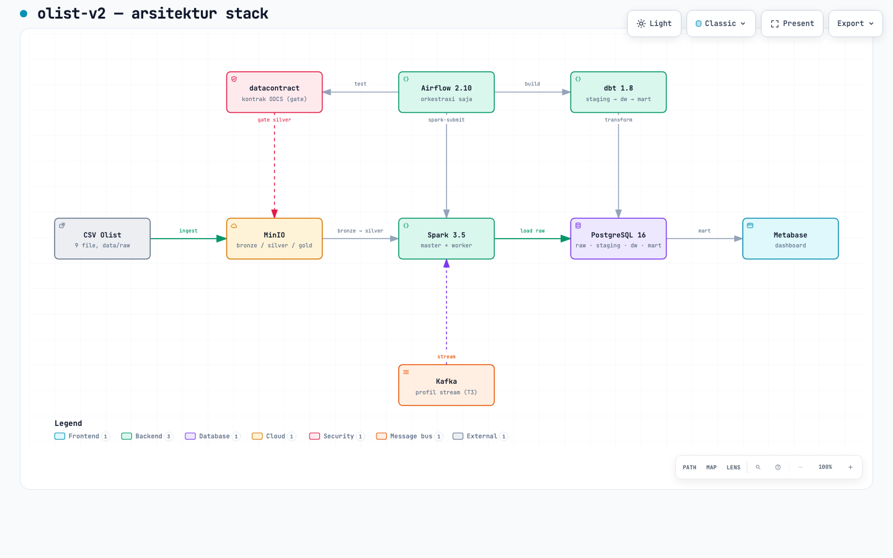
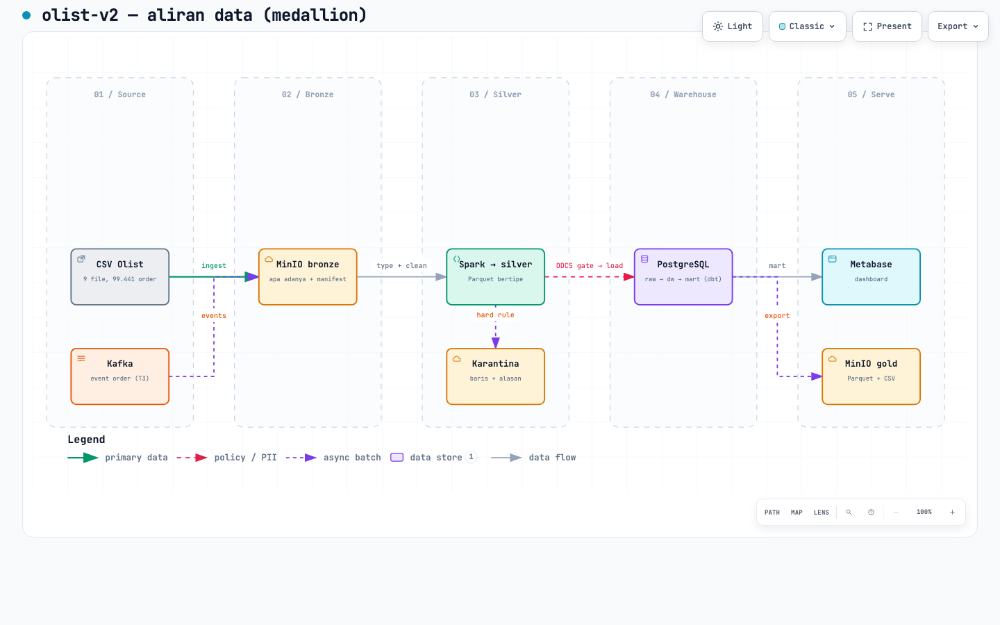
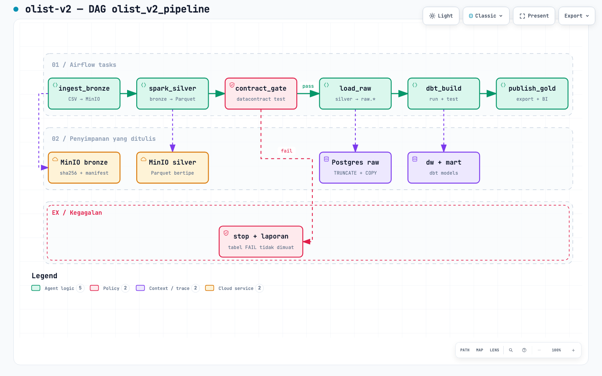

# olist-v2 — dokumentasi

Eksplorasi platform data: **Airflow + MinIO + Spark + dbt + Metabase + datacontract (ODCS) + Kafka** di atas PostgreSQL.
Dokumen ini ditulis untuk kamu sebagai pembangunnya: apa yang sudah ada, urutan langkah berikutnya, dan cara memeriksanya.

> **Posisi v2:** eksplorasi pribadi (tidak dinilai). **Ketentuan T0–T6 dipertahankan persis** (tata letak MinIO, manifest dengan checksum dan waktu update, gate, grain, angka cek, dst.) di [ALIGNMENT.md](ALIGNMENT.md); **alatnya boleh berbeda dan dinaikkan ke production-grade** di [PRODUCTION-GRADE.md](PRODUCTION-GRADE.md).

## Diagram (HTML interaktif + pratinjau)

Buka berkas `.html` di browser: ada pan/zoom, mode terang/gelap, pelacakan relasi, dan ekspor. PNG hanya pratinjau untuk Markdown.

| Diagram | HTML | Pratinjau | Menjawab |
|---|---|---|---|
| Arsitektur stack | [olist-v2.architecture.html](diagrams/olist-v2.architecture.html) |  | siapa memanggil siapa, dan di port mana |
| Aliran data (medallion) | [olist-v2.dataflow.html](diagrams/olist-v2.dataflow.html) |  | data bergerak dari CSV sampai dashboard |
| DAG `olist_v2_pipeline` | [olist-v2.workflow.html](diagrams/olist-v2.workflow.html) |  | urutan task Airflow dan jalur gagal |

Sumbernya JSON di [diagrams/](diagrams/) (`*.json`); HTML dibangkitkan dari JSON itu, jadi **ubah JSON-nya, jangan HTML-nya**. Membangun ulang:

```bash
A=~/.claude/skills/archify/bin/archify.mjs
node $A deliver architecture docs/diagrams/olist-v2.architecture.json docs/diagrams/olist-v2.architecture.html --quality showcase
node $A deliver dataflow     docs/diagrams/olist-v2.dataflow.json     docs/diagrams/olist-v2.dataflow.html     --quality showcase
node $A deliver workflow     docs/diagrams/olist-v2.workflow.json     docs/diagrams/olist-v2.workflow.html     --quality showcase
```

Ketiganya lolos 9 dari 9 pemeriksaan showcase dan pemeriksaan keterkungkungan layar 1440–2048 px (terang dan gelap). Catatan visual jujur: di diagram DAG, panah `ingest_bronze → MinIO bronze` dan `fail → stop` mengambil jalur tidak langsung. Keduanya valid dan tidak menimpa node, tetapi bukan jalur terpendek.

## Langkah demi langkah

Status: **ada** = sudah dibuat dan diperiksa · **ditulis** = file ada, belum dijalankan · **rencana** = belum ditulis.

| # | Langkah | Status | Berkas |
|---|---|---|---|
| 1 | [Isolasi dan persiapan](steps/01-isolasi-dan-persiapan.md) | ada | branch, `.env`, venv dbt |
| 2 | [Stack inti](steps/02-stack-inti.md) | ditulis | compose, Postgres, MinIO, Airflow |
| 3 | [Bronze: ingest ke MinIO](steps/03-bronze-ingest.md) | rencana | DAG task `ingest_bronze` |
| 4 | [Silver: Spark + kontrak ODCS](steps/04-silver-spark-kontrak.md) | rencana (image ditulis) | `spark/`, `contracts/` |
| 5 | [Warehouse: dbt](steps/05-warehouse-dbt.md) | rencana (venv ada); **keputusan jalur A/B** | `dbt/` |
| 6 | [Dashboard: notebook + Metabase](steps/06-dashboard-metabase.md) | rencana | profil `bi`, `notebooks/` |
| 7 | [Stream: Kafka](steps/07-stream-kafka.md) | ditulis; **wajib (T3, 20 %)** | profil `stream` |
| 8 | [Orkestrasi: DAG ujung ke ujung](steps/08-orkestrasi-dag.md) | rencana | `airflow/dags/` |
| 9 | [Verifikasi dan bukti](steps/09-verifikasi.md) | rencana | smoke, test, failure injection |

## Port (dari host)

| Layanan | Port | Profil |
|---|---|---|
| Airflow | 18080 | inti |
| MinIO API / web console | 19000 / **19001** | inti |
| PostgreSQL | 15432 | inti |
| Spark master UI / RPC / worker UI | 18090 / 17077 / 18091 | `spark` |
| Kafka / Kafka UI | 19092 / 18081 | `stream` |
| Metabase | 13000 | `bi` |
| Jupyter | 18888 | `lab` |
| Editor ODCS | 18082 | `contract` |
