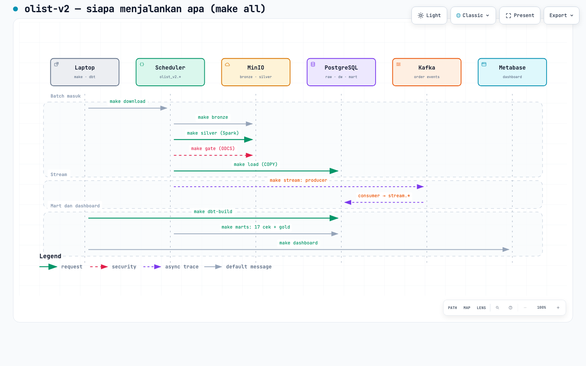

# olist-v2 — dokumentasi

Eksplorasi platform data: **Airflow + MinIO + Spark + dbt + Metabase + datacontract (ODCS) + Kafka** di atas PostgreSQL.
Dokumen ini ditulis untuk kamu sebagai pembangunnya: apa yang sudah ada, urutan langkah berikutnya, dan cara memeriksanya.

> **Posisi v2:** eksplorasi pribadi (tidak dinilai). **Ketentuan T0–T6 dipertahankan persis** (tata letak MinIO, manifest dengan checksum dan waktu update, gate, grain, angka cek, dst.) di [ALIGNMENT.md](ALIGNMENT.md); **alatnya boleh berbeda dan dinaikkan ke production-grade** di [PRODUCTION-GRADE.md](PRODUCTION-GRADE.md).

## Diagram (HTML interaktif + pratinjau)

Buka berkas `.html` di browser: ada pan/zoom, mode terang/gelap, pelacakan relasi, dan ekspor. PNG hanya pratinjau untuk Markdown.

| Diagram | HTML | Pratinjau | Menjawab |
|---|---|---|---|
| Arsitektur stack | [olist-v2.architecture.html](diagrams/olist-v2.architecture.html) |  | siapa memanggil siapa, dan di port mana |
| Aliran data (medallion + stream) | [olist-v2.dataflow.html](diagrams/olist-v2.dataflow.html) |  | data bergerak dari CSV sampai dashboard, dan jalur Kafka |
| DAG `olist_v2_pipeline` | [olist-v2.workflow.html](diagrams/olist-v2.workflow.html) |  | tujuh task Airflow, penyimpanan yang ditulis, dan jalur gagal |
| Siapa menjalankan apa (`make all`) | [olist-v2.run.html](diagrams/olist-v2.run.html) |  | perintah `make` mana menjalankan modul mana, di laptop atau container |

Sumbernya JSON di [diagrams/](diagrams/) (`*.json`); HTML dibangkitkan dari JSON itu, jadi **ubah JSON-nya, jangan HTML-nya**. Membangun ulang (pakai `deliver`, bukan `render`, supaya diperiksa):

```bash
A=~/.claude/skills/archify/bin/archify.mjs
node $A deliver architecture docs/diagrams/olist-v2.architecture.json docs/diagrams/olist-v2.architecture.html --quality showcase
node $A deliver dataflow     docs/diagrams/olist-v2.dataflow.json     docs/diagrams/olist-v2.dataflow.html     --quality showcase
node $A deliver workflow     docs/diagrams/olist-v2.workflow.json     docs/diagrams/olist-v2.workflow.html     --quality showcase
node $A deliver sequence     docs/diagrams/olist-v2.run.json          docs/diagrams/olist-v2.run.html          --quality showcase
```

### Peta berkas: perintah → modul → tempat jalan

| Perintah | Berkas yang dijalankan | Jalan di | Menulis ke |
|---|---|---|---|
| `make all` | `olist_v2/run_all.py` (memanggil 10 target di bawah) | laptop (venv) | `outputs/run_all.json` |
| `make download` | `olist_v2/download.py` (Kaggle CLI) | scheduler | `data/raw` |
| `make bronze` | `olist_v2/bronze.py` | scheduler | MinIO `bronze` + manifest |
| `make silver` | `olist_v2/silver.py` (+ `rules.py`, `contract.py`) | scheduler (Spark `local[2]`) | MinIO `silver`, karantina, `dq_report.md` |
| `make gate` | `olist_v2/gate.py` (`datacontract test`, venv terpisah) | scheduler | `contract_gate.md` |
| `make load` | `olist_v2/load.py` | scheduler | Postgres `raw.*` |
| `make stream` | `olist_v2/stream_cli.py` (+ `producer.py`, `consumer.py`, `stream.py`) | scheduler | Kafka, `stream.*`, `stream_report.md` |
| `make dbt-build` | `dbt/` (staging, dw, mart, 65 uji) | laptop (venv dbt) | Postgres `staging`/`dw`/`mart` |
| `make marts` | `olist_v2/marts.py` (+ `questions.py`) | scheduler | MinIO `gold`, `marts_report.md`, `dw.json` |
| `make dashboard` | `olist_v2/metabase.py` (+ `questions.py`) | laptop (venv) | Metabase (REST) |
| `make smoke` / `inject` / `restore` | `olist_v2/failures.py` (+ `smoke.py`) | laptop; tahap di container lewat `docker compose exec` | `failure_tests.md`, `failures.json` |
| `make benchmark` | `olist_v2/bench.py` | scheduler (Spark: python Airflow; DuckDB: venv datacontract) | `benchmark_report.md` |
| `make report` | `olist_v2/evidence.py` | laptop (venv) | `EVALUATION_EVIDENCE.md` |

DAG `olist_v2_pipeline` memanggil fungsi yang sama dengan target `make` di atas (`download` sampai `marts`), bukan salinan lain.

Catatan visual jujur (pemeriksaan containment 1440–2048 px lolos; tinjauan visual manual hanya pada tangkapan 1440×900 terang): di diagram aliran data, garis `export` ke gold berbagi jalur dengan panah `mart` sebelum berbelok; di diagram `run`, label legenda menyentuh bingkai segmen terakhir; di diagram DAG, panah `fail` ke `stop` berjalan di tepi bawah lane. Semuanya valid dan tidak menimpa node, tetapi bukan jalur terpendek. Diagram `run` memuat 10 dari 14 langkah: `make up` (compose) dan langkah verifikasi tidak digambar agar teks tetap terbaca.

## Langkah demi langkah

Status: **ada** = sudah dibuat dan diperiksa · **ditulis** = file ada, belum dijalankan · **rencana** = belum ditulis.

| # | Langkah | Status | Berkas |
|---|---|---|---|
| 1 | [Isolasi dan persiapan](steps/01-isolasi-dan-persiapan.md) | **ada** | branch, `.env`, venv dbt |
| 2 | [Stack inti](steps/02-stack-inti.md) | **ada** | compose, Postgres, MinIO, Airflow |
| 3 | [Bronze: unduh Kaggle + ingest ke MinIO](steps/03-bronze-ingest.md) | **ada** | `olist_v2/download.py`, `bronze.py` |
| 4 | [Silver, gate, dan load raw](steps/04-silver-spark-kontrak.md) | **ada** | `silver.py`, `gate.py`, `load.py` |
| 5 | [Warehouse: dbt](steps/05-warehouse-dbt.md) | **ada** (65/65) | `dbt/` |
| 6 | [Mart dan dashboard (Metabase)](steps/06-dashboard-metabase.md) | **ada** | `dbt/models/mart/`, `questions.py`, `metabase.py`, `marts.py` |
| 7 | [Stream: Kafka](steps/07-stream-kafka.md) | **ada** (replay penuh 35 s) | `stream_cli.py`, `producer.py`, `consumer.py` |
| 8 | [Orkestrasi: DAG ujung ke ujung](steps/08-orkestrasi-dag.md) | **ada** (stream belum di DAG) | `airflow/dags/` |
| 9 | [Verifikasi dan bukti (T6)](steps/09-verifikasi.md) | **ada** (6/6 kasus) | `failures.py`, `smoke.py`, `evidence.py`, `RUNBOOK.md` |
| 10 | [Benchmark silver: Spark vs DuckDB](steps/10-benchmark.md) | **ada** | `bench.py` |

Belum: Iceberg di silver, observability/lineage, uji beban (k6) untuk Metabase, dan run `make all YES=1` dari nol (termasuk build image).

## Port (dari host)

| Layanan | Port | Profil |
|---|---|---|
| Airflow | 18080 | inti |
| MinIO API / web console | 19000 / **19001** | inti |
| PostgreSQL | 15432 | inti |
| Spark master UI / RPC / worker UI | 18090 / 17077 / 18091 | `spark` |
| Kafka / Kafka UI | 19092 / 18081 | `stream` |
| Metabase | 13000 | `bi` |
| Jupyter | 18888 | `lab` |
| Editor ODCS | 18082 | `contract` |
